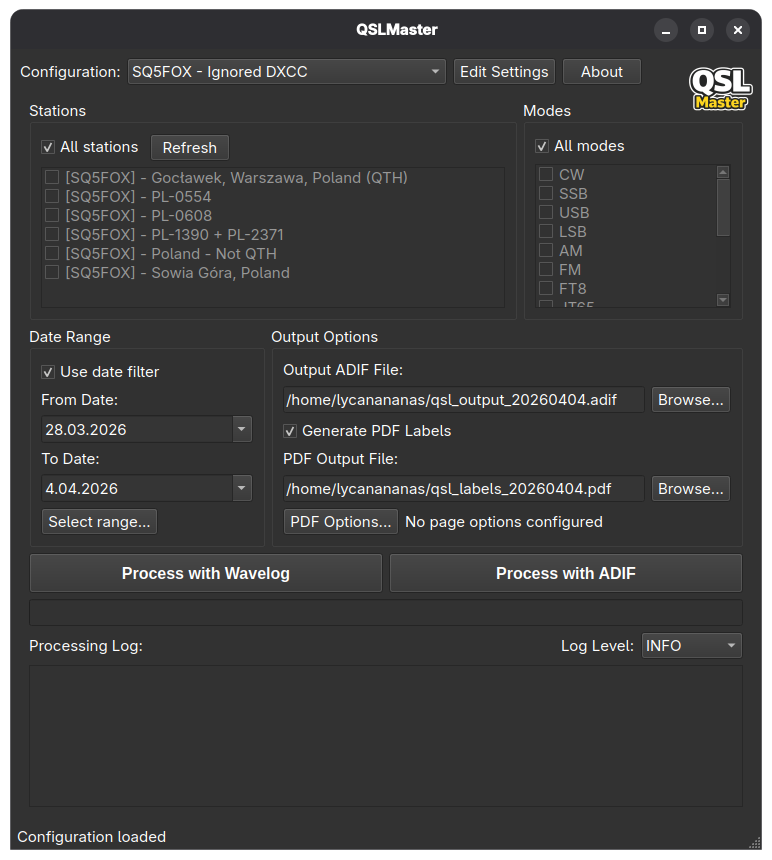
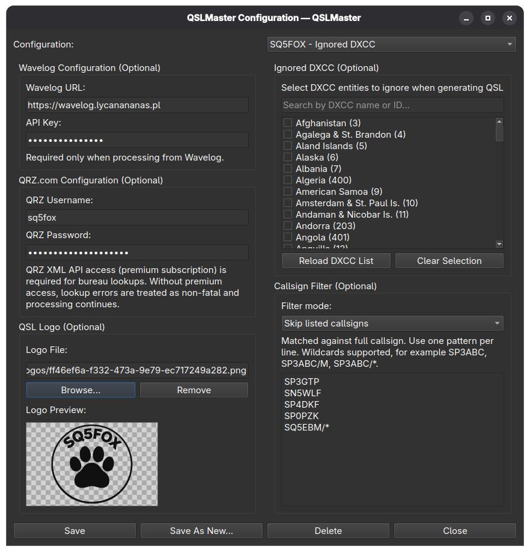
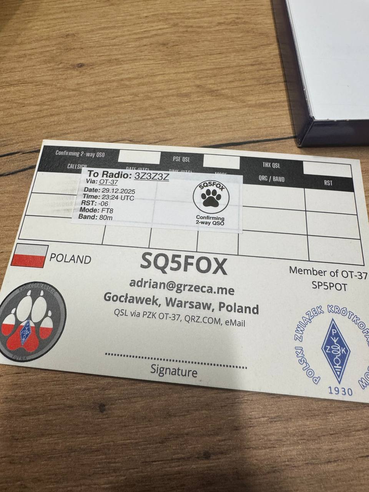
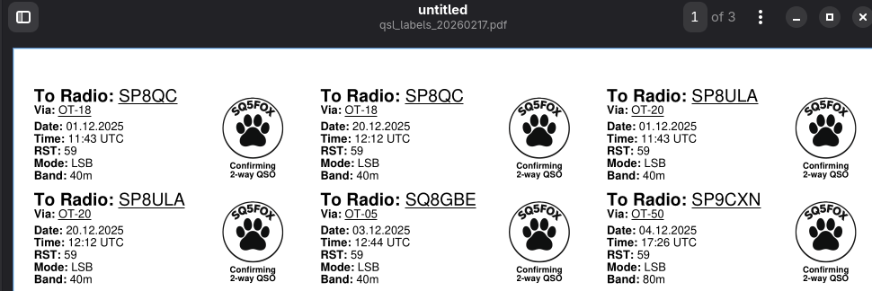

# QSLMaster


Download QSO data from Wavelog or a local ADIF file and prepare ADIF output and printable QSL labels. The project includes both a CLI and a GUI, sharing the same processing core.

## Features

- CLI and GUI based workflows
- ADIF loading/parsing from Wavelog API or local file
- Date range filtering
- Runtime source selection in GUI (`Process with Wavelog` or `Process with ADIF`)
- Callsign allow/block filtering against normalized homecall without wildcard support
- Ignored DXCC filtering and already sent QSO filtering
- QSL bureau verification via QRZ.com (optional)
- Country specific processing for Poland (PZK QSL bureau list lookup)
- Wavelog API v1 and API v2 support (detected automatically from the key)
- Server-side date and station filters with Wavelog API v2
- Mark as Sent in Wavelog: update QSL sent status from the generated ADIF file (API v2)
- Optional direct fallback when bureau lookup completes without a bureau match
- PDF label generation (Avery 70x25.4mm A4, 33 labels per sheet)
- Per-page PDF options for partially used label pages
- Background processing and live progress in GUI, network calls never block the window
- Hard abort of processing from GUI

## Requirements

- Python 3.9+
- Wavelog 2.0.0 or higher for API v1 keys, Wavelog 3.1.0 or higher for API v2 tokens (only when using `source: wavelog`)
- CLI dependencies in requirements.txt
- GUI dependencies in requirements-gui.txt

Tested only on Linux. Other platforms are currently untested.

## Installation

1. Clone the repository:
```bash
git clone https://github.com/lycanananas/QSLMaster.git
cd QSLMaster
```

2. Create virtual environment:
```bash
python3 -m venv venv
```

3. Activate virtual environment:
```bash
# On Linux/macOS:
source venv/bin/activate

# On Windows:
venv\Scripts\activate
```

4. Install CLI dependencies:
```bash
pip install -r requirements.txt
```

5. Install GUI dependencies (optional):
```bash
pip install -r requirements-gui.txt
```

## Install from Releases

Prebuilt packages and binaries are available on GitHub Releases:

https://github.com/lycanananas/QSLMaster/releases

- Ubuntu (`.deb`):
```bash
sudo apt install ./qslmaster_<VERSION>-1_<ubuntu-codename>_amd64.deb
```

- Arch Linux (`.pkg.tar.zst`):
```bash
sudo pacman -U ./qslmaster-<VERSION>-1-x86_64.pkg.tar.zst
```

- Windows:
  - Installer artifact: `*_installer` (`...-setup.exe`)
  - Portable binaries artifact: `*_no_installer` (`.zip`)

## Configuration

### CLI configuration file

1. Copy config.example.json to config.json:
```bash
cp config.example.json config.json
```

2. Edit config.json and fill in:
  - `source` - Data source: `wavelog` or `adif_file`
  - `api_key` - Your Wavelog API v1 key or API v2 token (required for `source: wavelog`, see [Wavelog API keys](#wavelog-api-keys))
  - `wavelog_url` - URL of your Wavelog instance (required for `source: wavelog`)
  - `adif_file_path` - Path to input ADIF file (optional in config; required at runtime for `source: adif_file` unless provided with `--adif-source`)
  - `qrz_username` - Your QRZ.com username (optional)
  - `qrz_password` - Your QRZ.com password (optional)
  - `ignored_dxcc` - List of DXCC IDs to skip during QSL generation (optional)
  - `callsign_filter_mode` - Callsign filter mode: `off`, `allow` or `block` (optional)
  - `callsign_filter_patterns` - Homecalls matched after callsign normalization, one exact value per entry, for example `SP3ABC`, `3Z3Z3Z` (optional)

Example config.json:
```json
{
  "source": "wavelog",
  "api_key": "your_api_key_here",
  "wavelog_url": "https://wavelog.example.com",
  "adif_file_path": "/path/to/input.adi",
  "qrz_username": "your_qrz_username",
  "qrz_password": "your_qrz_password",
  "ignored_dxcc": [15, 54],
  "callsign_filter_mode": "off",
  "callsign_filter_patterns": ["SP3ABC", "3Z3Z3Z"]
}
```

DXCC IDs `15` and `54` correspond to Asiatic Russia and European Russia.

QRZ.com credentials are optional. If not provided, bureau verification for non-Poland stations is skipped.
QRZ lookups require QRZ XML API access (premium subscription). Without premium access, QRZ lookup errors are treated as non-fatal and processing continues.

### Wavelog API keys

QSLMaster supports both Wavelog API versions. The version is detected automatically from the key format, so no extra setting is needed.

API v2 (recommended, Wavelog 3.1.0 or higher):
1. Log in to Wavelog and open the API section from the user menu.
2. Create a new API v2 token.
3. Select the scopes `qso:read` and `station:read`. Add `qso:write` only if you want to use [Mark as Sent in Wavelog](#mark-as-sent-in-wavelog).
4. Choose an expiry (30, 90, 365 days or never).
5. Copy the token right away. It starts with `wl2_` and is shown only once.

API v1 (legacy, Wavelog 2.0.0 or higher):
- Create a key with read-only (`r`) permission in the same API section.

QSLMaster only reads stations and QSOs. Your Wavelog log is changed only when you explicitly use Mark as Sent in Wavelog.

With an API v2 token, the selected date range and stations are sent to Wavelog, so only the needed QSOs are downloaded. API v1 always downloads the full log of the selected stations and filters it locally.

If your web server does not rewrite URLs, set `wavelog_url` to the address including `/index.php`, for example `https://wavelog.example.com/index.php`.

The same instructions are available in the GUI under `Edit Settings` with the `API Key Help` button. `Test Key` checks the URL, the key and its permissions without saving anything, and shows whether Mark as Sent is available.

### PZK bureau lookup

Polish callsigns are matched against the official PZK QSL bureau list `https://pzk.org.pl/osec_qsl.txt`. The list covers members, clubs and special callsigns. It is downloaded once per processing run and stored in the cache directory. If the PZK server is unavailable, the last downloaded copy is used and a warning is logged. The full callsign is matched first, then the homecall. A match sets `QSL_VIA` to the PZK branch, for example `OT-25`.

### Cache directory

The country file and the PZK list are cached in `~/.cache/qslmaster/`. Set the `QSLMASTER_CACHE_DIR` environment variable to use a different directory.

### GUI configuration and credentials

The GUI stores configuration in the user profile and keeps secrets in the system keyring.

In GUI, the source is selected at runtime when starting processing. Use `Process with Wavelog` to download QSOs from Wavelog or `Process with ADIF` to select a local ADIF file for the current run.

Wavelog connection settings remain optional until you actually start `Process with Wavelog`.

GUI runtime-only options include:
- PDF page options for partially used label pages
- Include direct when no bureau is found
- Hard abort of a running process

Config file locations:
- Linux: `~/.config/qslmaster/config.json`
- macOS: `~/Library/Application Support/qslmaster/config.json`
- Windows: `%APPDATA%\QSLMaster\config.json`

Keyring backends:
- Linux: `libsecret (GNOME Keyring) or KWallet`
- macOS: `Keychain`
- Windows: `Credential Manager`

## Usage

### GUI

Launch the GUI:
```bash
python -m qslmaster_gui.main
```

### CLI

Download all contacts:
```bash
python -m qslmaster_cli.main --config config.json -o output.adif
```

Use local ADIF file source:
```bash
python -m qslmaster_cli.main --config config.json --source adif_file --adif-source ./input.adi -o output.adif
```

List stations (Wavelog source only):
```bash
python -m qslmaster_cli.main --config config.json --source wavelog --list-stations-only
```

Filter by date range:
```bash
python -m qslmaster_cli.main --config config.json --from-date 2024-01-01 --to-date 2024-12-31 -o output.adif
```

Generate PDF labels:
```bash
python -m qslmaster_cli.main --config config.json -o output.adif --generate-pdf labels.pdf
```

Generate labels and include direct QSOs when no bureau is found in PZK or QRZ:
```bash
python -m qslmaster_cli.main --config config.json -o output.adif --generate-pdf labels.pdf --include-direct-when-no-bureau
```

The direct fallback is applied only when the lookup completes successfully but no bureau is found. Lookup errors and unavailable APIs are still treated separately and are not converted to direct automatically.

Filter by normalized homecall without wildcards:
```bash
python -m qslmaster_cli.main --config config.json -o output.adif --callsign-list-mode allow --callsign-pattern SP3ABC --callsign-pattern 3Z3Z3Z
```

Callsign filtering compares the normalized homecall. For example, the pattern `3Z3Z3Z` matches `3Z3Z3Z`, `3Z3Z3Z/P`, `LZ/3Z3Z3Z` and `HB/3Z3Z3Z/P`. Wildcards are not supported.

Generate PDF labels using partially used pages:
```bash
python -m qslmaster_cli.main --config config.json -o output.adif --generate-pdf labels.pdf --pdf-page-option "4|8,9" --pdf-page-option "0|5"
```

In `--pdf-page-option`, the format is `offset|skip1,skip2`:
- each consecutive `--pdf-page-option` defines the next page in order: first option = page 1, second option = page 2, third option = page 3, and so on
- `offset` means how many label positions are already used from the start of the page
- `skip1,skip2` are extra label numbers that should remain empty
- labels are numbered from left to right, then row by row from top to bottom

In the example above:
- `--pdf-page-option "4|8,9"` applies to page 1
- `--pdf-page-option "0|5"` applies to page 2
- page 3 and later use no offset and no skipped labels unless additional `--pdf-page-option` values are provided

Help:
```bash
python -m qslmaster_cli.main --help
```

### Mark as Sent in Wavelog

After the cards are printed and sent, QSLMaster can update the QSL sent status in Wavelog. It uses the output ADIF file of a processing run, so only the QSOs you actually prepared cards for are changed.

Requirements:
- Wavelog 3.2.5 or later
- API v2 token with the scopes `qso:read`, `station:read` and `qso:write`

For every QSO in the file, QSLMaster finds the matching Wavelog QSO by callsign, date, time and band (mode is used when more than one QSO matches) and sets:
- QSL sent = Yes
- QSL sent via = bureau or direct, as decided during processing
- QSL via = PZK branch, for example `OT-25`, when known
- QSL sent date = today or the selected date

QSOs that are not found, or that match more than one Wavelog QSO, are listed in the log and left unchanged.

Only ADIF files created by QSLMaster are accepted. This prevents a regular Wavelog export from overwriting sent dates of QSOs that were already marked as sent. Running Mark as Sent again with the same file is safe.

GUI: click `Mark as Sent in Wavelog`, select the output ADIF file, review the matched QSOs and the sent date, then confirm. While QSOs are being updated, the same button cancels the operation.

CLI:
```bash
python -m qslmaster_cli.main --config config.json --mark-sent output.adif --dry-run
python -m qslmaster_cli.main --config config.json --mark-sent output.adif
python -m qslmaster_cli.main --config config.json --mark-sent output.adif --sent-date 2026-11-20
```

`--dry-run` only shows what would be changed.

## Photos

### Application Interface





### QSL Card Example



### Generated PDF Labels



## Validating ADIF Output

After generating the ADIF file, validate its integrity:
```bash
python qslmaster_cli/validate_adif.py qsl.adi
```

## Testing

Unit tests run offline and do not need any account or network access:
```bash
pip install -r requirements-dev.txt
python -m pytest
```

GUI smoke tests in `tests/unit/test_gui_smoke.py` run when PyQt6 is installed and are skipped otherwise. On a machine without a display use `QT_QPA_PLATFORM=offscreen`.

The `ci` GitHub Actions workflow runs the tests on every push and pull request.

Live checks against external services are kept as scripts:

PZK QSL list download and lookup:
```bash
python tests/pzk_selftest.py
```

QRZ bureau verification (requires `qrz_username`/`qrz_password` in `config.json` and QRZ XML API premium access):
```bash
python tests/qrz_selftest.py --config config.json
python tests/qrz_selftest.py --config config.json --random 35
```

## Building

### Build CLI Package

```bash
python -m pip install --upgrade pip
pip install -r requirements-gui.txt
pip install pyinstaller pillow

# Optional (for icon generation used below)
python packaging/windows/build_icon.py

# Windows PowerShell/CMD variant (use ; in --add-data)
pyinstaller --noconfirm --clean --onefile --icon qslmaster.ico --paths . --collect-submodules qslmaster_gui --collect-submodules qslmaster_cli --add-data "qslmaster_gui/resources/icon.png;." --add-data "qslmaster.ico;." --name qslmaster-cli packaging/windows/entry_cli.py
```

### Build Arch Linux Package

Requires `makepkg`:
```bash
VERSION=$(python -c "from qslmaster_version import SOURCE_VERSION; print(SOURCE_VERSION)")
sed "s/__VERSION__/${VERSION}/g" arch/PKGBUILD.release > PKGBUILD.release
makepkg -p PKGBUILD.release -si
```

### Build GUI Standalone (PyInstaller)

```bash
python -m pip install --upgrade pip
pip install -r requirements-gui.txt
pip install pyinstaller pillow

# Optional (for icon generation used below)
python packaging/windows/build_icon.py

# Windows PowerShell/CMD variant (use ; in --add-data)
pyinstaller --noconfirm --clean --onefile --windowed --icon qslmaster.ico --paths . --collect-submodules qslmaster_gui --collect-submodules qslmaster_cli --add-data "qslmaster_gui/resources/icon.png;." --add-data "qslmaster.ico;." --name qslmaster packaging/windows/entry_gui.py
```

The executable will be in `dist/` directory.

## Troubleshooting

Keyring not available:
- Ubuntu/Debian GNOME: `sudo apt-get install gnome-keyring dbus-user-session`
- Ubuntu/Debian KDE: `sudo apt-get install kwalletmanager`
- Arch Linux (GNOME): `sudo pacman -S gnome-keyring libsecret`
- Arch Linux (KDE): `sudo pacman -S kwalletmanager`

Cache issues:
```bash
rm -rf ~/.cache/qslmaster/
```

## API Documentation

- Wavelog API v1: https://github.com/wavelog/wavelog/wiki/API
- Wavelog API v2: https://docs.wavelog.org/developer/api-v2/
- PZK QSL bureau list: https://pzk.org.pl/osec_qsl.txt
- QRZ.com XML API: https://www.qrz.com/page/api


## License

QSLMaster is distributed under the GNU General Public License v3.0. For details, see LICENSE.md or https://www.gnu.org/licenses/gpl-3.0.en.html

## Releases

Release history is in [CHANGELOG.md](CHANGELOG.md). The release procedure is described in [RELEASING.md](RELEASING.md).

## Contributing

Contributions are welcome. Please open issues or pull requests. Run `python -m pytest` before opening a pull request and add a line to the `CHANGELOG.md` section of the upcoming version for user visible changes. Never commit configuration files, API keys or real logs.
